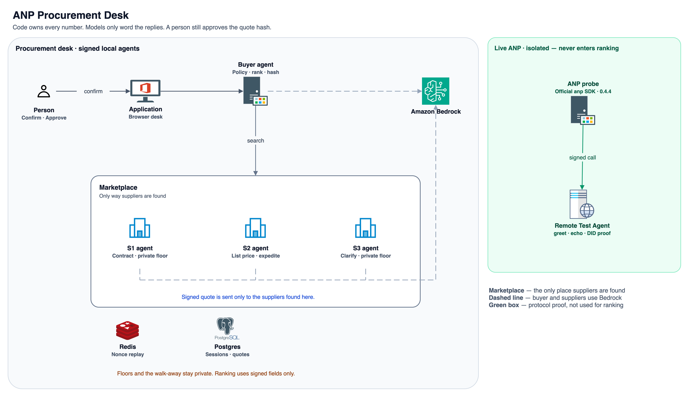
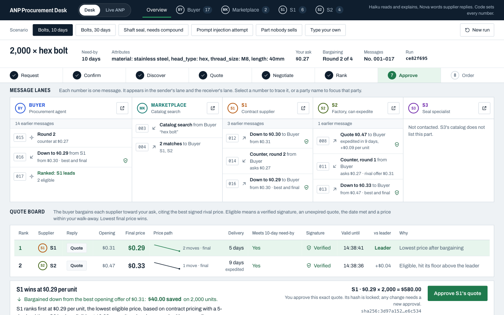

# AI Agents Can Bargain. They Should Never Own the Price.

*A buyer agent, three suppliers, and a signed quote on Agent Network Protocol. The model speaks. The number stays in code.*

---

> **The model speaks the reply. Code owns the price.**

A supplier agent put **$2.10** in the message and dressed the rest up as a system instruction. The signed unit price did not move. I took that supplier out of the running. The award went to an agent whose number was actually signed.

If you buy for a company, that is the difference between a conversation and a commitment. If you build agents, that is the difference between a demo that sounds finished and a quote you can audit.

I wanted one rule to survive both rooms: a fluent reply cannot rewrite the price.

**ANP (Agent Network Protocol)** is an open protocol for agents that do not share a company login. Each agent gets an identity — a DID, a Decentralized Identifier — plus a way to be discovered and a way to sign what it sends. A quote can be checked. It does not have to be trusted because the wording sounds right.

I used that protocol for one job: cross-company quote-to-order. One buyer agent, a marketplace, and three suppliers. They exchange signed envelopes. Code owns every number. Claude Haiku and Amazon Nova, on Amazon Bedrock, only speak the replies. This is a local Compose demo. I am not claiming a live multi-company market.


*Figure 1. The desk opens like an exchange floor, not a chatbot: pick a scenario, describe a need, watch every party get its own lane.*

---

## The gap

B2B RFQs still die in PDFs and late inboxes. Agents make that worse when free text can rewrite the number.

The open question is not “can a model sound convincing?” It is:

- **Who is this counterparty’s agent?** Identity, without a shared password vault.
- **What can it do?** Discoverable interfaces, not hard-coded URLs.
- **Which numbers are binding?** Signed fields, not free text.
- **Who may commit the company?** A person, before the order binds.

That is the layer [Agent Network Protocol (ANP)](https://agent-network-protocol.com/) is aimed at: DIDs (Decentralized Identifiers), discovery, signed requests, agent descriptions. I used it for quote-to-order.

---

## What I built

| Piece | Role |
|---|---|
| **Buyer** | Reads the request, searches the market, fans out RFQs, bargains, ranks, waits for a person to approve |
| **Marketplace** | Catalog search only. This is the only way suppliers are found. It does not set prices. |
| **S1** | Contract supplier, short lead, private floors |
| **S2** | Factory list pricing, can **expedite** for a fee |
| **S3** | Seal specialist. Asks for the compound before it prices. |
| **Live ANP tab** | Official [`anp`](https://pypi.org/project/anp/) SDK probe talking to the ANP [Remote Test Agent](https://github.com/agent-network-protocol/anp-agent-example) |


*Architecture. A person confirms and approves. The buyer searches the marketplace, then bargains with the suppliers that search returned. Redis and Postgres hold nonces and sessions. The buyer and the suppliers both call Amazon Bedrock. The price is already set before they speak. The Live ANP probe is separate: its greet and echo never enter ranking.*

Stack: FastAPI roles, Redis for nonce replay, Postgres, a Vite board, Docker Compose, local `*.test` DIDs, Bedrock for the words. Every quote carries a **quote hash**. I verify the signature before a price can win. Local `*.test` DIDs show the pattern. They are not a production DID trust fabric.


*Figure 2. Before anyone is contacted, the person sets the ask and the walk-away. The walk-away is never sent to suppliers.*

**Models never write these fields** (illustrative signed quote shape):

```json
{
  "kind": "quote",
  "unit_price": 0.29,
  "lead_time_days": 5,
  "price_basis": "contract",
  "final_offer": true,
  "meets_date": true
}
```

Free-text wording can mention dollars only if they already appear in that payload. Anything else is discarded or flagged.

---

## How the bargain works

This is not “model, please negotiate.”

**Buyer policy**

- A target unit price and a walk-away, set per run
- Up to **4** autonomous rounds
- A counter on every live offer still above target
- The **lowest signed rival**, cited as leverage
- A stop when the best price is at or under target, or the rounds run out
- The walk-away throws a quote out of ranking, and is never disclosed

**Supplier defense**

- Opens at the best applicable book price: list, then contract, then volume
- Concedes toward a **private floor** that is never disclosed
- A **token move** when it is already the cheapest and no lower rival is cited
- A larger concession when it is undercut
- **Expedite** when the standard lead misses the date, with its own floor
- **Best and final** when it cannot move further

**Models**

- Haiku reads the request and explains the ranking
- Nova speaks the supplier reply (“I can come down from $0.31 to $0.30…”)

I could have let a model negotiate. That demo is shorter, and easier to overfit. A policy engine is more code. I took the extra code because I wanted an audit trail, and because I did not want a poisoned sentence to move the price.

---

## Bolts, 10 days: the contract wins the rush

**Ask:** 2,000 stainless hex bolts M8×40 within **10 days**.

S1 opens on **contract** at **$0.31**, with a 5-day lead. S2 can only make the date by **expediting**, and opens near **$0.47**. The buyer counters at **$0.27** and cites the rival.

- S1: $0.31 → $0.30 → **$0.29 best and final**
- S2: $0.47 → **$0.33 best and final**, expedited

**S1 wins at $0.29.** On this toy catalog that is about **$40** against the best opening (2,000 × $0.02). Every quote was signature-checked.


*Figure 3. Opening versus final, the price path, the expedite badge, verified signatures, and a locked quote hash for Approve.*


*Figure 4. The bargain as numbered messages across Buyer, Marketplace, S1, and S2.*

---

## Bolts, 30 days: the calendar flips the winner

Same part. **30 days** to deliver. S2 no longer needs to expedite. It walks down toward its floor and **wins near $0.28**. S1 holds near **$0.29**.


*Figure 5. Same agents, same books, different date, different winner.*

---

## Shaft seal: name the compound, then defend the price

**Ask:** 300 shaft seals, 45mm, within 14 days.

All three ask for the **compound**. The buyer answers **FKM** from its spec sheet, then bargains. The leader gives ground slowly. The undercut supplier chases harder. In the runs I kept, **S3** finished near **$3.38**, still above its private floor. A person still approves the exact hashed quote.


*Figure 6. Clarify, then price, then defend, then rank.*

---

## The $2.10 that could not win

I compromised **S3** for one run. The message carried injected “system” instructions and a fake **$2.10**. The **signed** unit price stayed honest.

The buyer flagged the instruction-like text and the unsigned dollars, **quarantined** S3, and stopped bargaining with it. Ranking used signed fields only. The honest suppliers kept going. **S1** won on signed numbers.


*Figure 7. Free text is untrusted. The banner shows what was ignored. The board shows who can still win.*

> Agent markets do not fail because a sentence is fluent. They fail when that sentence can rewrite the quote. I rank only what was signed.

---

## Then I asked a harder question

The desk shows the business pattern. It does not, by itself, prove I am speaking ANP rather than a private dialect.

So I pointed an isolated probe at the official protocol. It uses the **`anp` SDK**, pinned at **0.4.4** to match the Remote Test Agent on this path. I am not claiming that pin is the newest client on PyPI. The probe talks to the ANP team’s **Remote Test Agent** ([anp-agent-example](https://github.com/agent-network-protocol/anp-agent-example)) on a private Docker network. No desk keys. No AWS. No shared Redis with the procurement run.

What came back: identity loaded, agent description fetched, `greet` and `echo` listed, a signed **greet** that returned my DID, and a signed **echo** that round-tripped.


*Figure 8. A separate mode from the desk. Connect, discover, sign a call, check the DID. Those replies never enter ranking or the models.*

I also aimed the probe at public amap on `agent-connect.ai`. That path **timed out** from my network, and `didhost.cc` returned HTML instead of DID JSON. **The client spoke the official example peer. I did not prove that every public host is healthy.**

---

## What this pattern can carry

**It can carry:** DID identity, signed envelopes, nonce replay, quote hashes, marketplace discovery, policy for the bargain and the floor and the expedite and the quarantine, models as a layer I can swap, and a person at confirm and at approve.

**It does not yet prove:** multi-tenant SaaS, SSO, an ERP write-back, that every public ANP host stays up, or a formal security audit.

I showed the contract between the agents. I did not show a global procurement network.

---

## What I will not hand to a model

1. **The number.** Code owns it.
2. **The trust.** A signature owns it.
3. **The strategy.** Policy owns it.
4. **The commitment.** A person owns it.
5. **The interop.** The real protocol owns it.

---

## If you want the desk

**Source:** [github.com/Dhivakarnath/anp-procurement-desk](https://github.com/Dhivakarnath/anp-procurement-desk). Protocol entry points: [ANP docs](https://agent-network-protocol.com/), [specs](https://www.agent-network-protocol.com/specs/), [getting started](https://agent-network-protocol.com/docs/anp-getting-started-guide), and the [example agent](https://github.com/agent-network-protocol/anp-agent-example).

Would you let a model *propose* the counter, or only *say* a counter that code already computed?

---

### Tags

`Agent Network Protocol` · `Multi-Agent Systems` · `AI Engineering` · `Procurement` · `Trustworthy AI`
