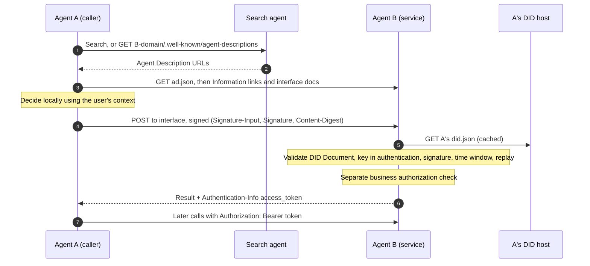

# ANP (Agent Network Protocol): Context for a Production Build

- Research date: 2026-10-30
- Spec set: ANP 1.2 (spec repo commit `0837cfd`, 2026-10-23)
- SDK: AgentConnect `anp` 1.0.7 on PyPI, crates.io and the Go proxy (released 2026-10-22). The local clone that was reviewed is 1.0.6 (`bab0a0e`).

This file is the summary. The detailed notes under `docs/research/` contain the exact field names, JSON examples, test vectors and per-role MUST/MUST NOT checklists.

| File | Covers |
|---|---|
| [research/01-identity-auth.md](research/01-identity-auth.md) | did:wba, DID Documents, ANP-02 HTTP signatures, tokens, key rotation, did:web, test vectors |
| [research/02-naming-authz.md](research/02-naming-authz.md) | WNS handles (ANP-04), ANP-05 OAuth/VC authorization draft |
| [research/03-application-layer.md](research/03-application-layer.md) | White paper, Agent Description (ANP-07), meta-protocol (ANP-06), AP2 payments (ANP-10), IETF draft, use cases |
| [research/04-messaging.md](research/04-messaging.md) | ANP-09 and messaging profiles P1–P9, MVP subset, error codes |
| [research/05-sdk.md](research/05-sdk.md) | AgentConnect SDK feature matrix, Python API, known bugs and spec deviations |

---

## 1. What ANP is

ANP is an open protocol suite (Apache-2.0) that lets AI agents on the open internet identify each other, publish what they can do, find each other, and exchange authenticated or end-to-end encrypted messages. Gaowei Chang (formerly of Alibaba Cloud) started it in 2024, and it became a community project in April 2025. It reuses HTTP, DNS, TLS and Web hosting. It does not use a blockchain.

The suite answers six questions:

| Question | ANP answer | Spec |
|---|---|---|
| Who is this agent? | A W3C DID, normally `did:wba` (Web-based, hosted as `did.json` on the agent's domain) or native `did:web` | ANP-03, Appendix B |
| How do I verify a request from it? | RFC 9421 HTTP Message Signatures with a key from the caller's DID Document | ANP-02 |
| What is it called? | A WNS handle such as `alice.example.com` that resolves to a DID | ANP-04 |
| What can it do? | An Agent Description (`ad.json`) listing information resources and interfaces (OpenRPC, OpenAPI YAML, natural language) | ANP-07 |
| How do I find it? | `/.well-known/agent-descriptions` on a domain, or registration with a search agent | ANP-08 |
| How do we talk? | JSON-RPC messaging with DID-addressed direct and group messages, attachments, federation, optional E2EE | ANP-09 + P1–P9 |

### 1.1 ANP compared with MCP and A2A

| | MCP | A2A | ANP |
|---|---|---|---|
| Connects | A model host to tools and data | An agent to another agent, by delegating a task | Agents in different organizations on the open internet |
| Identity | OAuth 2.1, run by the server operator | OpenAPI-style auth schemes; signed Agent Cards since v1.0 (March 2026) | A W3C DID carried in every request, with no per-platform registration |
| Discovery | Not part of the core protocol | `/.well-known/agent.json`, one card per domain | `/.well-known/agent-descriptions` (many agents per domain), search agents, handles |
| Interaction | The client calls tools on the server | The caller sends a task and gets artifacts back | The caller reads Information, decides locally, then calls an Interface. The white paper says decision-making stays with the caller. |
| Messaging | None | Task messages | DID-addressed direct and group messages, attachments, federation, E2EE |
| Governance | Agentic AI Foundation (AAIF, Linux Foundation) | AAIF since August 2026 | ANP community, W3C Community Group, AAIF Sandbox proposal filed |

The ANP authors describe the three as complementary. An MCP server or an A2A task endpoint can be published as an interface in an ANP Agent Description, and ANP's DID authentication can give clients of other protocols one identity across services. The getting-started guide's rule of thumb: use MCP to connect tools, use A2A-style protocols for controlled workflows, and use ANP when agents must find and talk to each other across domains.

---

## 2. Status and ecosystem (October 2026)

**Standards work**
- The W3C AI Agent Protocol Community Group was started in May 2025, with Gaowei Chang as co-chair. A Community Group can publish reports but is not on the W3C Recommendation track.
- The IETF individual draft `draft-zyyhl-agent-networks-framework` (-01, October 2025) was co-written with Huawei, China Mobile, China Telecom and China Unicom. It covers a single operator trust domain only.
- According to the AAIF proposal, Huawei and China Mobile put ANP forward in May 2026 as a candidate protocol in 3GPP's 6G AI agent studies.
- The AAIF project proposal (`aaif/project-proposals#46`) asks for Sandbox stage. Acceptance depends on AAIF review.
- The technical white paper is on arXiv (2508.00007).

**Adoption, as claimed in the AAIF proposal**
- **AWiki** (awiki.ai, Hangzhou Vector Consensus Technology) uses ANP identity and messaging for collaboration between humans and agents. It has an open-source server, a Rust CLI and a Flutter app.
- **Trade Agent Network** (Beijing Wanlian Zhilian) runs cross-enterprise trade agents at `club.iagentnet.cn`.
- **Third-party experiments:** FAX, HelloAgents/Datawhale tutorials, the uni-agent adapter, ATTP and the CORE Lab 5G/6G toolkit. The proposal itself says these do not show conformance or production use.
- **Community size:** 50+ contributors and about 2,000 members, mostly in WeChat groups.

**Independent assessments**
- A June 2026 review by Ry Walker counted about 1,300 GitHub stars and no named enterprise production deployments. It called ANP a long-horizon infrastructure bet. That review came before the ANP 1.2 documents and the 1.0.x SDKs.
- A University of New Brunswick threat-modeling paper (arXiv 2602.11327) found no formal adversary model, protocol-level attack analysis or adversarial testing for ANP.
- A protocol survey (arXiv 2505.02279) proposes adopting MCP, then ACP, then A2A, and adding ANP last for decentralized agent marketplaces.

**What this means for a production project.** The released specs are detailed and testable: ANP-02 ships 112 byte-level vectors and 215 scenario vectors. The ecosystem is small, though, and the SDK changes quickly (7 patch releases in 6 weeks, some of them changing behaviour). A new build will be one of only a few independent implementations. Pin versions, run interop tests against the reference SDK, and keep draft specs behind adapters.

---

## 3. Spec map: what is stable

| Spec | Status | Defines | Production stance |
|---|---|---|---|
| ANP-01 White paper | Informative v1.2 (vNext draft revision 2026-09-27) | Vision, principles, architecture | Context only |
| ANP-02 DID Authentication | **Released 1.2** | RFC 9421 request signatures, RFC 9530 digests, challenges, errors, optional tokens | **Build on it** |
| ANP-03 did:wba | **Released 1.2** | Identifier syntax, resolution, `e1_` key binding, DID Document proof, rotation | **Build on it** |
| Appendix A / B | **Released 1.2** | `k1_` secp256k1 profile / native `did:web` | Use B if you already have did:web |
| ANP-04 WNS | **Released 1.2** | Handles, resolution endpoint, bidirectional binding | Build on it if you need human-readable names |
| ANP-05 Authorization | Draft v0.7, outside 1.2 | OAuth with CIMD client URLs; VC delegation | Isolate behind an adapter. The VC section body is missing in v0.7 (see 5.7) |
| ANP-06 Meta-protocol | Draft | `anp.negotiate`, `MetaProtocolInterface` | Optional; feature-flag only |
| ANP-07 Agent Description | **Released 1.2** | `ad.json`, interfaces, `humanAuthorization` | **Build on it** (some parts under-specified, see §9) |
| ANP-08 Discovery | **Released 1.2** | `.well-known/agent-descriptions`, passive registration | **Build on it** |
| ANP-09 Messaging P1–P5, P7–P9 | **Released 1.2** | JSON-RPC envelope, direct and group messaging, E2EE, attachments, federation, mentions | Build on it |
| P6 Group E2EE | Candidate | MLS group encryption | Experimental; the wire format will change when the MLS code point `0xF0A1` is registered |
| ANP-10 AP2 payments | Draft (EN v1.1) | Cart and payment mandates, QR payment flow | Design reference only; internally inconsistent |

`Version: 1.2` is the document version, not a wire version. Wire identifiers carry their own major versions (`anp.direct.base.v1`, `anp.group.base.v2`), and `ad.json` carries `protocolVersion` (examples use `1.0.0`).

---

## 4. How two agents connect



Resolution chain: handle or search result → DID → DID Document → `AgentDescription` or `ANPMessageService` service → runtime capabilities → business interface or messaging profile.

The DID Document is authoritative for keys and endpoints. A handle, an Agent Description or a display profile never overrides it. Allowed shortcuts:
- Known contacts can be messaged directly.
- Known interfaces can be called directly.
- Public information can be read without authentication.
- The meta-protocol is skipped when the declared interfaces are enough.

---

## 5. Implementation essentials by layer

### 5.1 Identity: did:wba (ANP-03)

**Identifiers and resolution**

| DID | Resolves to |
|---|---|
| `did:wba:example.com` | `https://example.com/.well-known/did.json` |
| `did:wba:example.com:user:alice:e1_<fp>` | `https://example.com/user/alice/e1_<fp>/did.json` |
| `did:wba:example.com%3A3000:user:alice:e1_<fp>` | `https://example.com:3000/user/alice/e1_<fp>/did.json` |

- IP addresses are not allowed. The TLS certificate must match the host through a SAN `dNSName`, never the CN. The returned document's `id` must equal the DID exactly.
- **Root (bare-domain) DIDs** identify a domain or service. Use one as `ANPMessageService.serviceDid` for server-to-server signatures.
- **Path DIDs** identify agents and users. New path DIDs MUST end with an `e1_` fingerprint.

**`e1_` fingerprint**
1. Decode the Ed25519 `publicKeyMultibase` (`z6Mk…`) to `0xED 0x01 || pk32`.
2. Build the JWK `{"crv":"Ed25519","kty":"OKP","x":"<b64url(pk32)>"}` with no whitespace, members in that order (RFC 7638).
3. SHA-256 it, then base64url-encode without padding (43 characters).
4. Prefix `e1_`.

Test vector: `x=g0UoJP1oc-BCiT8pJa8lfekejLLEzPjheYJBn4jj8TE` → `e1_TzEBgIcHmLjwuFomfsQSV6cifXvw-DW5MpIl4Q2I6ik`.

**DID Document contents**
- `@context`, which must include did/v1, data-integrity/v2 and multikey/v1.
- `id`.
- `verificationMethod`: an Ed25519 Multikey, plus an X25519 key for key agreement.
- `authentication` and `assertionMethod`, both containing the binding key; `keyAgreement` with the X25519 key.
- `service` entries: `AgentDescription` (pointing to `ad.json`), `ANPHandleService`, and `ANPMessageService` (with `serviceDid`).
- `proof`: `DataIntegrityProof`, `eddsa-jcs-2022`, `proofPurpose: assertionMethod`.
  - Signing input: `SHA-256(JCS(proof options + @context)) || SHA-256(JCS(document without proof))`.

**Hard validation rules for active `e1_` documents.** Resolution fails if any of these is false:
- the proof exists and verifies;
- the proof key is in `assertionMethod`;
- that key's thumbprint equals the `e1_` segment.

There is no relaxed mode.

**Rotation.** A new binding key means a new DID with the same stable subject path (`example.com:user:alice`).
- The old document stays online with `deactivated: true` and a `successorDid`, and is never rewritten.
- Verifiers walk the chain hop by hop. They rate each hop as `verified`, `recovery_verified`, `provider_asserted` or `unverified`, and cache only the first two.
- A matching path prefix never proves continuity.

### 5.2 Request authentication (ANP-02)

```http
POST /orders HTTP/1.1
Content-Digest: sha-256=:<b64 sha256(body)>:
Signature-Input: sig1=("@method" "@target-uri" "@authority" "content-digest");created=1733402096;expires=1733402156;nonce="abc123";keyid="did:wba:client.example:agents:alice:e1_...#key-1"
Signature: sig1=:<b64 signature>:
```

**Server pipeline, in order** (error codes in parentheses):

| # | Check | Error |
|---|---|---|
| 1 | Headers are present, and `Content-Digest` is present when there is a body. | `invalid_request` |
| 2 | Covered components include `@method`, `@target-uri`, and `content-digest` if there is a body. `created` is present. `keyid` is a full DID URL. | `invalid_request` |
| 3 | The digest is recomputed over the exact received bytes and matches. | `invalid_content_digest` |
| 4 | The DID method is supported. The DID Document resolves and validates under its method. A deactivated DID is never used; 409 `did_superseded` may be returned. | `invalid_did` |
| 5 | The `keyid` verification method exists, is unique, and is listed in `authentication`. Assertion-only keys are rejected. | `invalid_verification_method` |
| 6 | The RFC 9421 signature base is rebuilt from the actual request, using the received `@signature-params` string verbatim. The algorithm comes from the key type. | `invalid_signature` |
| 7 | The time window is 1 to 5 minutes and configurable. | `invalid_timestamp` |
| 8 | Replay check: a single-use nonce in a shared cache, kept longer than the signature lifetime. Nonce-less replays, label-swapped replays and concurrent duplicates are rejected. A nonce is not consumed when the signature is bad. | `invalid_nonce` |
| 9 | Business authorization is a separate check (403). | `forbidden_did` |
| 10 | Optional token, returned only in `Authentication-Info: access_token="…", token_type="Bearer", expires_in=3600`. It must never be sent in an `Authorization` response header. | — |

- **Failure response:** `401` with `WWW-Authenticate: DIDWba realm="…", error="…", nonce="…"`, `Accept-Signature: …` and `Cache-Control: no-store`. If the challenge includes a nonce, the client must re-sign using it.
- **Non-HTTP transports:** JSON carriage uses `{"auth":{contentDigest, signatureInput, signature}, "payload":{…}}`, with the digest computed over `JCS(payload)`.

### 5.3 Naming: WNS handles (ANP-04)

**Handle syntax and resolution**
- A handle is `local-part.domain`. The local part is 1–63 characters from `[a-z0-9-]`, starts and ends with a letter or digit, and contains no `--`. Input is lowercased, and the domain has no port.
- `wba://` is an optional sharing prefix that clients strip before use.
- Resolve with `GET https://{domain}/.well-known/handle/{local}`.
  - Required fields: `handle`, `did`, `status` (`active`, `suspended` or `revoked`) and `binding_generation`.
  - `binding_generation` is a decimal string that only ever increases. It protects against rollback, so store the highest value seen.
  - The getting-started guide's example leaves `binding_generation` out. Follow ANP-04.

**Bidirectional verification.** Required before authentication, authorization, choosing a message recipient, or any write:
1. Resolve the handle to a DID.
2. Resolve the DID Document.
3. Find its `ANPHandleService` entry. It must be HTTPS on the handle's domain.
4. Fetch that endpoint. The result is one of:
   - `exact-handle`: the endpoint equals the resolution URL, and both `did` and `handle` match.
   - `provider-confirmed`: a DID-only confirmation.
   - `unverified`.

Security decisions require `exact-handle`.

**Lifecycle**
- Handles are permanent per subject, cannot be transferred, and are never reused. A revoked handle leaves a permanent tombstone.
- The `profile` block is display metadata only. Never use it for auth, routing or encryption.

### 5.4 Agent Description (ANP-07)

**Fields**
- **Required:** `protocolType: "ANP"`, `protocolVersion`, `type: "AgentDescription"`, `name`, `securityDefinitions`, `security`.
- **Optional:** `url`, `did`, `owner`, `description`, `created`, `Infomations` (the misspelling is the official field name), `interfaces`, `proof`.

**Interfaces**
- An interface entry is `{type, protocol, version, url | content, description, humanAuthorization}`.
- `type` is `NaturalLanguageInterface` or `StructuredInterface`; the ANP-06 draft adds `MetaProtocolInterface`.
- `protocol` values seen in the spec: `openrpc`, `YAML` (either OpenAPI 3 or a custom ANP YAML), `MCP` (format "to be supplemented"), `WebRTC` (undefined).
- Callers should prefer structured interfaces. The spec recommends that every agent also offer a natural-language interface.

**Security and authorization fields**
- `securityDefinitions: {"didwba_sc": {"scheme": "didwba", "in": "header", "name": "Authorization"}}` describes only where the follow-up Bearer token goes. The first call is still signed with RFC 9421. Never put secrets in `ad.json`.
- `humanAuthorization: true` only declares that a human must approve. It is not a credential and not evidence. The caller must collect approval and the server must enforce its own evidence check.

**Data model**
- The crawler-style pattern: the agent publishes URLs, and other agents fetch them, reason locally, and call interfaces only when needed. This avoids handing user context to a remote agent.
- `ad.json` is plain JSON. Discovery documents are JSON-LD. Some live agents still serve the older JSON-LD shape with `ad:` prefixes, so parsers should accept both.

### 5.5 Discovery (ANP-08)

**Active discovery**
- `GET https://{domain}/.well-known/agent-descriptions` returns a JSON-LD `CollectionPage`.
- `items[]` entries are `{"@type":"ad:AgentDescription","name":"…","@id":"<ad.json URL>"}`.
- Follow `next` until there are no more pages. List only public agents.

**Passive discovery**
- The agent reads the search agent's `ad.json`, finds its registration interface, and submits its own AD URL.
- The search service then verifies, crawls and indexes it. The registration API is defined by each search service, not by ANP.

### 5.6 Messaging (ANP-09, profiles P1–P9)

**Envelope (P1)**
- JSON-RPC 2.0 sent over HTTPS or WSS to `ANPMessageService.serviceEndpoint`.
- `id` must be a string, `params` must be an object, and batch requests are not allowed.
- `params = {meta, auth?, body}`. `meta` holds `profile`, `security_profile`, `sender_did`, `target{kind, did}`, `operation_id`, `message_id`, `created_at` and `content_type`.
- **Idempotency key:** `(sender_did, target_scope, method, operation_id)`, checked before any other state check.
- **Errors:** `{code, message, data:{anp_code, retryable}}`. Shared codes are 1000–1021. Profile codes: direct 2000s, group 3000s, direct E2EE 4000s, group E2EE 5000s, attachments 6000s.
- **Origin proof** (`anp-rfc9421-origin-proof-v1`): an RFC 9421 signature over `JCS({method, meta, body})`, with `@target-uri = anp://{kind}/{pct-encoded did}`. Relays forward it unchanged.

**Profile reference**

| Profile | Key methods |
|---|---|
| P1 Core `anp.core.binding.v1` | `anp.get_capabilities`, which may be called anonymously. Runtime answers override the DID Document hints. |
| P2 Identity `anp.identity.discovery.v1` | Exactly one `ANPMessageService` per DID Document. A `deviceManifest` is needed only for E2EE. |
| P3 Direct `anp.direct.base.v1` | `direct.send` (origin proof required), `direct.incoming` notification. No read receipts and no ordering guarantee. |
| P4 Group `anp.group.base.v2` | `group.create`, `get_info`, `join`, `add`, `remove`, `leave`, `update_profile`, `update_policy`, `send`. The host orders everything. Roles are owner, admin and member. |
| P5 Direct E2EE `anp.direct.e2ee.v2` | Prekey bundles, X3DH-like session setup and a Double-Ratchet-like ratchet. One ciphertext per recipient device. No silent downgrade. |
| P6 Group E2EE `anp.group.e2ee.v2` | MLS with one leaf per device. **Candidate**, gated on the `0xF0A1` code point. |
| P7 Attachments `anp.attachment.v1` | `attachment.create_slot`, `commit_object`, `abort_object`, `get_download_ticket`. Object bytes move over HTTPS with Bearer tickets valid for at most 5 minutes. |
| P8 Federation `anp.federation.relay.v1` | Server-to-server RFC 9421 signatures with `serviceDid`, plus a caller-anchor check. The original method is forwarded. Depends on P4. |
| P9 Mentions | A `mentions[]` array in group JSON payloads. |

**Minimum first release** (direct messaging and attachments, no E2EE)
- Advertise P1, P2, P3 and P7 with `transport-protected` only.
- Implement P8 behaviour for cross-domain direct calls, but do not advertise P8 until P4 exists.
- Design idempotency keys and delivery queues so a device dimension can be added later for P5.

### 5.7 Drafts: authorization, meta-protocol, payments

**ANP-05 Authorization (v0.7, draft)**

When to use which mechanism:

| Need | Mechanism |
|---|---|
| Prove which DID sent a request | ANP-02 |
| Access controlled by the resource side (user consent, machine-to-machine, revocation) | OAuth |
| Authority from outside the resource side (an organization appoints an agent; one mandate shown to many services) | Verifiable Credentials |

OAuth profile:
- `client_id` is an HTTPS Client ID Metadata Document (CIMD) URL, never the DID.
- In `did_bound` mode the DID Document carries an `ANPCIMD` service with `anp_metadata_sha256`.
- Clients authenticate with `private_key_jwt`.
- Mandatory: S256 PKCE, RFC 8707 resource indicators, and the RFC 9207 `iss` check.

Status problems:
- The body of the VC section (§11) is empty in v0.7; upstream commit `6683793dc1` deleted it. The repo's own doc tests fail 38 of 103 because of this.
- Do not build a VC verifier until it is restored.
- The `cimd` mode is standard OAuth and the lowest-risk part to implement.

**ANP-06 Meta-protocol (draft)**
- Flow: `MetaProtocolInterface` → `anp.get_capabilities` → `anp.negotiate` → a `NegotiationResult` with `selected{interface, protocol, securityProfile}`, `validUntil` and `negotiationDigest`.
- The server selects among its own interfaces. No code generation is involved; the old binary negotiation flow is deprecated.
- A negotiation result is never authorization.

**ANP-10 AP2 payments (draft)**
- Flow: the merchant signs a CartMandate as a JWS over `cart_hash`. The user pays by QR code (Alipay or WeChat). The shopper sends a PaymentMandate signed as a JWS over `[cart_hash, pmt_hash]`.
- Known gaps:
  - The signature algorithms (RS256, ES256K) don't match Ed25519 DID keys.
  - The recommended `exp` is 180 days in one place and 15 minutes in another.
  - The reference "JCS" code is not RFC 8785.
  - There is no receipt or refund schema.

---

## 6. SDK reality (AgentConnect)

**Feature matrix** (✅ full, 🟡 partial, ❌ absent)

| Feature | Python | Go | Rust | TS | Dart | Java |
|---|---|---|---|---|---|---|
| DID create and resolve (e1/k1, did:web) | ✅ | ✅ | ✅ | ✅ | ✅ | 🟡 |
| ANP-02 RFC 9421 sign and verify | ✅ | ✅ | ✅ | ✅ | ✅ | ❌ |
| Verifier with token issuance | ✅ | ✅ | ✅ | ✅ | 🟡 | 🟡 |
| Proofs and WNS | ✅ | ✅ | ✅ | ✅/🟡 | ✅ | ❌ |
| `ad.json` and OpenRPC generation, JSON-RPC server | ✅ | ❌ | ❌ | ❌ | ❌ | ✅ |
| Remote-agent client and crawler (with OpenAI tool format) | ✅ | ❌ | ❌ | ❌ | ❌ | ✅ |
| Direct E2EE P5 | v1 ✅, v2 wire only | v1 ✅, v2 wire only | ✅ v2 runtime | ❌ | 🟡 | ❌ |
| Group E2EE P6 (MLS) | ❌ | 🟡 | ✅ (test-only) | ❌ | ❌ | ❌ |
| AP2 mandates | ✅ | ❌ | ❌ | ❌ | ❌ | 🟡 |

**Recommended use**
- **Python `anp[api]==1.0.7`** is the only SDK covering the application layer. Its identity, proof and WNS core is tested against Go and Rust with shared vectors.
- **Rust** suits E2EE and other crypto-heavy parts.
- **Go** suits a lightweight verifier sidecar.
- **Avoid Java**: it lacks RFC 9421, so it cannot talk to servers using current defaults.

**Deviations and bugs to fix around the SDK.** These come from the code review; the line numbers are in research/05-sdk.md §9.

Spec deviations (they apply to Python, Go, Rust and TS):
1. The verifier rebuilds `@signature-params` in a fixed order instead of using the received string. Signers that order the parameters differently, or add `alg` or `tag`, fail verification. This breaks RFC 9421.
2. The verifier does not enforce the required covered components. If a client leaves `content-digest` uncovered, the body can be swapped.
3. Tokens are also sent in an `Authorization` response header by default (`emit_legacy_authorization_header=True`). ANP-02 forbids this.
4. The legacy `DIDWba` header is accepted by default.
5. Some status and error codes differ from the spec:
   - 403 instead of 401 `invalid_verification_method`;
   - `invalid_signature` instead of `invalid_content_digest`.
6. No verifier handles `deactivated`/`successorDid` (409 `did_superseded`).
7. The server never issues challenge nonces.

Python implementation issues:
8. The replay cache is an in-process dict. It is not shared across workers or pods.
9. There is no DID Document cache and no injectable resolver.
10. **OpenANP never enables auth.** `AgentConfig.auth_config` is unused, so `@anp_agent` servers are unauthenticated unless you add the middleware. Without it, every caller shares one `anonymous` session.
11. `ANPClient` silently sends unauthenticated requests when key loading or signing fails.
12. `RemoteAgent` builds a new client per call and never reuses tokens.
13. RPC errors leak `str(e)` to callers.
14. URL building ignores proxies. Behind TLS termination, signatures and published URLs break unless uvicorn runs with `--proxy-headers`.
15. OpenANP and FastANP emit two different `ad.json` shapes.

**Testing gaps.** No SDK test runs the official ANP-02 vectors against the verifiers. CI is a single workflow that is only triggered by hand.

---

## 7. Use cases

| Use case | Source | ANP parts needed | Readiness |
|---|---|---|---|
| Personal assistant books a hotel or flight across vendors without scraping or per-vendor accounts | Getting-started guide, ANP-07, ANP-06 | DID auth, AD, discovery, structured interface, `humanAuthorization`, payment | Core released; payment is a draft |
| Business trip: airline, hotel, map and expense agents; the user confirms only at payment | vNext white paper §1.3 | Same, plus messaging | Same |
| Cross-organization procurement: search → supplier ADs → local budget comparison → E2EE chat about lead times → approver → DID-signed order → role credential → payment → shipping documents as attachments | vNext white paper §10.1 | Every layer, including ANP-05 VC and ANP-10 | Authorization and payment are drafts |
| Enterprise HR agent with an organization-issued role credential and per-transaction limits | vNext white paper §8.3 | ANP-05 VC | Draft; VC text currently missing |
| Coffee ordering with customization (cup size, temperature, sweetness) | `examples/adp/lkcoffe` | AD with `customizationOptions`, structured purchase interface | Released |
| Hotel search and booking (Sheraton example: OpenAPI search, booking with human approval, streamed NL `/ask`) | `examples/adp/hotel` | AD, OpenAPI, NL interface | Released |
| Search or directory agent that indexes ADs (agent-search.ai) | ANP-08, white paper §3.4.2 | Discovery, AD, auth | Released |
| Messaging between humans and agents and between agents, across products (AWiki) | AWiki, AAIF proposal | DID, WNS, P1–P5, P7 | Released (P6 candidate) |
| Cross-enterprise trade: supply-demand matching, procurement, logistics and finance agents | AAIF proposal (iagentnet.cn) | Identity, discovery, messaging | Released |
| E-commerce purchase paid by QR code | ANP-10 | AP2 mandates | Draft |
| Adding ANP to LLM agent frameworks (OpenManus, OWL: "one prompt + one HTTP function") | ANP blog | Crawler client | Released |
| Relaying E2EE traffic through a third-party platform that cannot read it | White paper §3.2 | P5, P8 | Released (P5) |
| Multiple DIDs for privacy (sub-DIDs for shopping, food delivery and similar) | White paper §4.3 | Identity | Released |
| Telecom: intent-based 6G network agents, device-network collaboration, remote rescue (robot dog, arm, drone), home security, fixed-mobile handover | IETF draft, IETF124 decks (China Mobile, Telecom, Unicom), 3GPP TR 22.870 | Framework level, single trust domain | Requirements only |
| Interop with MCP/A2A: publish an MCP server or A2A task endpoint as an ANP interface; reuse ANP DID auth for MCP clients | vNext white paper §2.4, AAIF proposal | AD, ANP-02 | The MCP interface format in ANP-07 is still "to be supplemented" |

---

## 8. Production-grade checklist

**Identity and keys**
- Create an `e1_` Ed25519 binding key per agent, plus a separate X25519 key for key agreement.
- Keep private keys in a KMS/HSM and sign through a callback (`generate_http_signature_headers(..., sign_callback)`). Never put keys in the repo, images or logs.
- Serve each `did.json` over HTTPS with a certificate whose SAN matches the host.
- On rotation, keep the old document online (`deactivated` + `successorDid`) and never edit it again. Use compare-and-swap so a DID can't get two successors.
- Use a bare-domain service DID for server-to-server signatures.

**Inbound authentication**
- Enforce the required covered components.
- Verify against the received `@signature-params` string exactly as sent.
- Use a shared replay store (Redis `SET NX EX`) whose entries outlive the signature lifetime. Handle concurrent duplicates and don't consume a nonce when the signature is bad.
- Keep clocks synced with NTP. Use a 1–5 minute window.
- Send tokens only in `Authentication-Info`. Use JWTs with `iss`, `aud`, `exp` and `scope`, short lifetimes, and rotated signing keys.
- Return 401 with `WWW-Authenticate: DIDWba`, `Accept-Signature` and `Cache-Control: no-store`.
- Turn legacy `DIDWba` off.
- Keep authorization a separate, deterministic policy decision (OPA/Cedar or code), never an LLM judgment.

**Outbound fetches** (DID documents, ADs, handles, interface docs, information links)
- Defend against SSRF: block private and special-use IPs, defend against DNS rebinding, and don't follow cross-origin redirects carrying credentials.
- Cap response size (for example 1 MiB), set timeouts, and limit crawl depth.
- Cache DID Documents with a short TTL. Never cache a temporary resolution failure as "deactivated". Force a refetch when a cached key fails.

**LLM safety**
- Treat AD descriptions, Information content and incoming messages as untrusted data, not instructions (prompt injection).
- Gate `humanAuthorization` interfaces behind user confirmation on the caller side. The server enforces its own evidence.
- Disclose the minimum. Use a sub-DID per scenario.

**State and scale**
- Keep app instances stateless. Use Redis for nonces and short-lived state, and Postgres for messages, idempotency records, grants and handles.
- Idempotency follows P1. Keep records at least as long as the longest sender retry period.

**Operations**
- Behind proxies, trust only known forwarded headers or set a fixed external base URL. `@target-uri` must match what the client signed.
- Write structured logs with no tokens, keys or signatures.
- Use `x_trace_id`/transport tracing, never inside signed data.
- Track metrics per auth error code. Rate-limit with 429 and `Retry-After`.

**Conformance and interop**
- Run the ANP-02 vectors in CI: `byte-vectors.json` (32 positive, 80 negative) and `scenario-vectors.json` (215 scenarios).
- Run round-trip interop tests against the AgentConnect Python and Rust SDKs.
- Pin the SDK version and track upstream releases.
- Don't use `docs/did-wba-server-test-interface.md` for 1.2 conformance. It describes the deprecated scheme.

**Versioning**
- Advertise only what you implement. Runtime `anp.get_capabilities` overrides the DID Document hints.
- Never silently downgrade security.

---

## 9. Spec gaps you must decide on

| # | Gap | Suggested decision |
|---|---|---|
| 1 | The ANP-07 security example names the `Authorization` header, but the first call uses RFC 9421 headers. | Keep the example block for compatibility; document the real flow in the interface docs. |
| 2 | The field is spelled `Infomations`; live ADs also use the legacy JSON-LD `ad:` keys. | Emit `Infomations`. Parse both shapes and both spellings. |
| 3 | The `ad.json` `proof` has no `cryptosuite`, and its example uses `EcdsaSecp256r1Signature2019`. | Sign with `DataIntegrityProof` + `eddsa-jcs-2022` using the agent's DID key, plus `domain` and `challenge`. |
| 4 | `security` is a string in ANP-07, an object in the Product example, and an array in ANP-06. | Emit a string; accept all three. |
| 5 | The replay key is "(keyid, nonce)", yet the nonce is optional. | Require a nonce, or key on a hash of the signature base. |
| 6 | For a deactivated DID the spec suggests 409 `did_superseded`; the vectors use 401 `invalid_did`. | Return 409 with `currentDid` as a hint only. |
| 7 | No DID Document cache TTL. | Use ≤ 5 min, honor `Cache-Control`, refetch on verification failure. |
| 8 | The ABNF allows `.` and `..` path segments, a path traversal risk. | Reject them. |
| 9 | `@target-uri` behind proxies is undefined. | Configure an external base URL per route. |
| 10 | Messaging defines no HTTP status mapping, WSS framing or notification delivery channel. | HTTP 200 for every JSON-RPC response; WSS (or a webhook) for `direct.incoming`; document both. |
| 11 | P8 depends on P4. | Don't advertise P8 in a direct-only release. |
| 12 | ANP-05 §11 (VC) is empty in v0.7. | Defer VC; ask the maintainers to restore the section. |
| 13 | WNS ignores IDN, has no HTTP code for `suspended`, and has no explicit verifier rule for `binding_generation` rollback. | A-label domains only; treat `suspended` as unresolvable; reject a lower generation. |
| 14 | The messaging examples contain errors (stale `anp.group.base.v1`, `operation_id ≠ message_id` under P5, `initial_members` field naming). | Follow the profile text, not the examples. |

---

## 10. Candidate projects

The candidates below build only on released specs, except where noted. All of them rely on the same identity and authentication core.

### A. ANP Agent Gateway (recommended first build)
A gateway that turns any existing HTTP API, OpenAPI service or MCP server into an ANP agent, without changing the backend.
- **DIDs:** hosts DID Documents for your agents and a service DID. Keys stay in a KMS. Rotation follows ANP-03.
- **Publishing:** generates `ad.json` per agent from OpenAPI/OpenRPC, and a paginated `/.well-known/agent-descriptions`. Optional WNS handles.
- **Inbound verification:** a spec-conformant ANP-02 verifier that fixes the SDK deviations in §6, with a Redis replay store, an SSRF-safe cached resolver, `Authentication-Info` tokens and 409 `did_superseded`.
- **Policy:** a policy hook (caller DID → allowed operations) and a `humanAuthorization` approval hook.
- **Outbound client:** a signing client library with connection pooling and token reuse.
- **CI:** an official ANP-02 vector suite and interop tests against AgentConnect.
- **Specs:** ANP-02, 03, 04, 07, 08, all released.
- **Why first:** it fills the biggest gaps in today's SDK, it can be tested against official vectors, and projects B–D reuse it.

### B. Agent Discovery and Search Service
A service like agent-search.ai.
- **Crawling and registration:** crawls `/.well-known/agent-descriptions` and accepts passive registrations.
- **Verification:** validates ADs with a tolerant parser, verifies the DID, the handle (`exact-handle`) and AD proofs, and tracks freshness and health.
- **Search and API:** offers structured and semantic search. It publishes its own `ad.json` with an OpenRPC search and registration interface plus an NL interface.
- **Abuse controls:** rate limiting and spam scoring.
- **Specs:** ANP-07, 08, 02, 03, 04, all released.

### C. Federated ANPMessageService
A DID-addressed messaging server (compare awiki-open-server).
- **Profiles:** P1, P2, P3 and P7, plus P8 behaviour.
- **Core:** `anp.get_capabilities`, `direct.send`, origin proofs, idempotency, attachments with tickets, server-to-server signatures, WSS delivery to local agents.
- **Later:** P4 groups and P5 E2EE.
- **Specs:** released, but this is the largest scope.

### D. Vertical application: cross-organization procurement network
Buyer and supplier agents that use structured quote and order interfaces, messaging and attachments, with human approval of orders.
- **Dependencies:** built on A, and optionally B and C.
- **Draft areas:** organization role credentials (ANP-05 VC) and payments (ANP-10) are drafts. They need your own adapters, built to be replaced when the specs stabilize.

---

## 11. Sources

**Specifications and SDK**
- [ANP specification repository](https://github.com/agent-network-protocol/AgentNetworkProtocol) (cloned and read in full, commit `0837cfd`)
- [AgentConnect SDK](https://github.com/agent-network-protocol/AgentConnect) (cloned, commit `bab0a0e`); registries: PyPI `anp`, crates.io `anp`, Go module `github.com/agent-network-protocol/anp/golang`
- [ANP website](https://agent-network-protocol.com/)
- [ANP technical white paper, arXiv 2508.00007](https://arxiv.org/abs/2508.00007)

**Standards and governance**
- [W3C AI Agent Protocol Community Group](https://www.w3.org/community/agentprotocol)
- [IETF draft-zyyhl-agent-networks-framework-01](https://www.ietf.org/archive/id/draft-zyyhl-agent-networks-framework-01.html)
- [AAIF project proposal for ANP (issue #46)](https://github.com/aaif/project-proposals/issues/46): history, adoption claims, roadmap
- [Forbes: Agent2Agent joins the Agentic AI Foundation](https://www.forbes.com/sites/janakirammsv/2026/08/19/agent2agent-joins-the-agentic-ai-foundation-alongside-mcp/): A2A v1.0 and signed Agent Cards

**Adoption and assessments**
- [AWiki (awiki.ai / anpclaw.com)](https://anpclaw.com/)
- [Ry Walker research note on ANP (June 2026)](https://rywalker.com/research/anp-agent-network-protocol)
- [Security threat modeling of MCP, A2A, Agora and ANP, arXiv 2602.11327](https://arxiv.org/html/2602.11327v1)
- [Survey of agent interoperability protocols, arXiv 2505.02279](https://arxiv.org/abs/2505.02279)

Content from web sources was rephrased for compliance with licensing restrictions.
